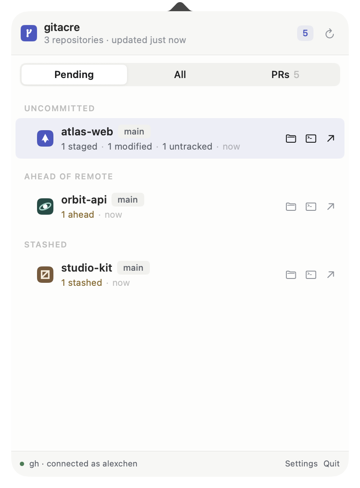

<p align="center">
  
</p>

<h1 align="center">gitacre</h1>

<p align="center">
  <strong>Your Git work, one glance away.</strong><br>
  A native macOS menu-bar app for local changes, linked worktrees, and pull requests.
</p>

<p align="center">
  <a href="https://gitacre.shivamx96.com">Download</a>
  ·
  <a href="release-notes/1.0.0-beta.4.md">Release notes</a>
</p>

<p align="center">
  
</p>

gitacre keeps the Git work that needs your attention close at hand—without making you open a terminal. Choose the folders where your repositories live and gitacre quietly monitors them from the menu bar.

## What it shows

- **Pending local work:** staged, modified, untracked, conflicted, ahead, behind, and stashed states in one compact list.
- **Linked worktrees:** every checkout stays grouped beneath its repository, with branch-level status and direct actions.
- **Pull requests:** review requests and PRs opened by you, using the GitHub CLI session already active on your Mac.
- **Quick actions:** reveal a checkout in Finder, open it in your preferred terminal, or visit its remote repository.
- **A native macOS experience:** keyboard navigation, automatic background refresh, launch at login, light and dark appearances, and a global Option-Command-G shortcut.

## Get started

1. [Download the latest beta](https://gitacre.shivamx96.com).
2. Open the disk image and drag `gitacre` into Applications.
3. Launch gitacre, open Settings, and choose the folders that contain your repositories.
4. Look for the gitacre icon in the menu bar, or press Option-Command-G.

The Pull Requests view is optional. To use it, install the [GitHub CLI](https://cli.github.com/) and sign in with `gh auth login`. Local repository monitoring works without GitHub or network access.

## Requirements

- macOS 14 Sonoma or later
- Apple silicon or Intel Mac
- Apple’s system Git (`/usr/bin/git`), provided by Xcode or its Command Line Tools
- GitHub CLI only for the optional Pull Requests view

## Private by construction

Repository scanning happens locally. For pull requests, gitacre invokes the official GitHub CLI and reuses its active `github.com` session; it does not read or store your authentication token.

Repository scans never fetch or write. Ahead and behind counts reflect the remote-tracking references already present on your Mac.

## Build from source

Building gitacre requires an Xcode toolchain with Swift 6.1 or newer, matching [`Package.swift`](Package.swift). Check the selected toolchain with `swift --version`.

```sh
git clone https://github.com/shivamx96/gitacre.git
cd gitacre
scripts/build-app.sh
open build/gitacre.app
```

The build script creates a universal app for Apple silicon and Intel, signed locally for development. For a faster build targeting only your Mac, use `scripts/build-app.sh debug`.

For a development run without creating an app bundle:

```sh
swift run Gitacre
```

Run the test suite with:

```sh
swift test
```

## Project resources

- The static product site and its screenshots live in [`website/`](website/).
- Maintainers can find signing, notarization, and packaging instructions in [`docs/RELEASING.md`](docs/RELEASING.md).
- Bugs and feature requests can be reported through [GitHub Issues](https://github.com/shivamx96/gitacre/issues).

gitacre is currently prerelease software.

### Performance diagnostics

Settings → Advanced → **Export performance…** saves a versioned JSON snapshot.
Recording is always in memory: the newest 2,000 fixed-shape events plus session
aggregates. Nothing is periodically written to disk. Restarting the app starts a
new session. Export before quitting, ideally immediately after reproducing a spike.

The timeline records local refresh triggers, requested/selected scope, queued and
combined requests, scan completion, superseded results, publication, GitHub refresh
lifecycle, Git/CLI commands, filesystem batches, panel visibility, sleep/wake, and
refresh settings. `requestID` correlates work; `relatedRequestID` connects a queued
request to the active or pending request. Coalesced work retains the earliest
request's ID, trigger and timestamp, so completion totals are attributed to that
first trigger; individual incoming triggers remain visible as request/queue events.

Event fields are deliberately fixed and contain no paths, URLs, branch names,
arguments, output, or file contents. Repository/worktree identifiers are
process-randomized Swift hashes, stable only within that process; they are not
cryptographic anonymization. No growing repository identity map is retained.
The existing **Copy report** remains a separate configuration report.

Reading an export:

- `aggregates` keys are `event.trigger.command`; counters and duration histograms
  cover the entire session, even after timeline entries have been overwritten.
- `overwritten` reports discarded timeline entries; `sequence` preserves order.
- `cpu` is `getrusage` CPU seconds at export time for this process and for every
  reaped child process (git, gh). It is the only CPU measure in the file and is
  still not energy; GPU, disk, and wake-up costs need external tools.
- `requested.discovery` and `started.discovery` describe the requested scope;
  `completed.discovery` is the scope that actually ran. The worker upgrades a
  status refresh to discovery when it has no baseline for the configuration.
- Discovery `selected.duration` covers the root walk and one `rev-parse` per
  checkout before per-repository work starts; `selected.worktrees` is the number
  of checkouts that walk found and `selected.count` the repositories selected.
  `completed.count` and `worktrees` describe the resulting full snapshot.
  `completed.commandCount` counts subprocesses in that scan, including discovery.
  `completed.failed` means at least one repository reported a scan failure.
- Filesystem `count` means unique paths in a delivered batch, not raw OS events.
  `insideGitDirectory` counts paths inside a `.git` directory (index, refs, logs
  written by Git or an IDE); `unmatched` counts paths outside known repositories;
  `rescan` indicates OS flags requiring discovery. This instrumentation does not
  change filtering or refresh policy.
- Queue/start `count` is waiting callers, not concurrent scans. There is at most
  one active scan and one pending combined scan. `superseded` means a worker result
  was discarded; its `relatedRequestID` usually equals its own `requestID` because
  the follow-up re-runs under the earliest ID. `publicationSkipped` means an
  individual UI caller was obsolete; with coalesced callers only the newest one
  publishes, so one `published` event follows several `publicationSkipped` events.
- `published.duration` measures earliest request/batch delivery to model publication,
  including queueing and superseded scans. It is not physical-write-to-screen latency.
  `changed: false` identifies publications with unchanged repository data.
- GitHub: `githubRequested` starts a load; `githubQueued` is a caller that arrived
  while one was active (`relatedRequestID` is the active load) and collapses into a
  single follow-up that runs under the earliest queued ID. `githubCompleted` carries
  elapsed time, `commandCount` (`gh` calls including detail batches), `count` rows,
  and `failed` when the CLI was unavailable or reported an error. `githubPublished`
  measures earliest caller to model publication; `githubSkipped` means a newer
  configuration made the result obsolete. Commands with trigger `detail` are
  on-demand PR detail loads for visible rows and have no lifecycle events.
- Duration bucket upper bounds are 10ms, 50ms, 100ms, 500ms, 1s, 5s, 30s, then infinity.
  Durations and `uptime` use the awake-time monotonic clock, which does not advance
  while the Mac sleeps. Command durations are elapsed time, **not CPU time**;
  concurrent command durations can exceed total scan time (`scanConcurrency` is the
  subprocess width). Command `exitStatus` is `-1` when the child could not be
  launched or was terminated after a timeout.
- Standalone CLI commands outside any lifecycle, such as a `git init` from tests,
  have no request context.

Run `swift test --filter PerformanceDiagnosticsTests` for ring eviction, concurrent
recording, context propagation, export, classification and command failure checks.
